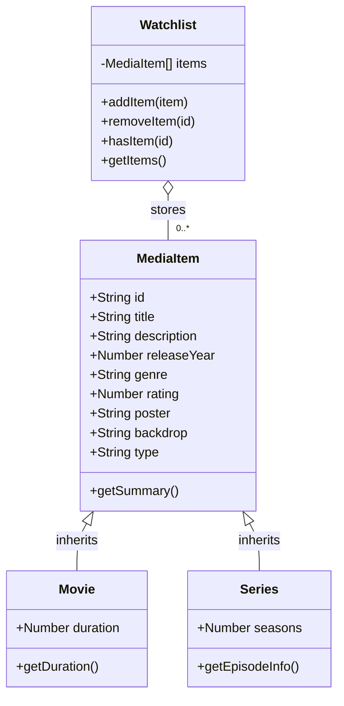

# CineVault Class Diagram

Paste the Mermaid code below into https://mermaid.live, then export it as PNG or PDF for submission.

## How the diagram maps to the app

- **MediaItem** is the shared parent model for common title information.
- **Movie** inherits `MediaItem` and adds `duration`.
- **Series** inherits `MediaItem` and adds `seasons`.
- **Watchlist** stores media objects and provides add, remove, and lookup behavior.
- `mediaData.js` creates `Movie` and `Series` instances. React components render those objects dynamically rather than repeating title information in JSX.
